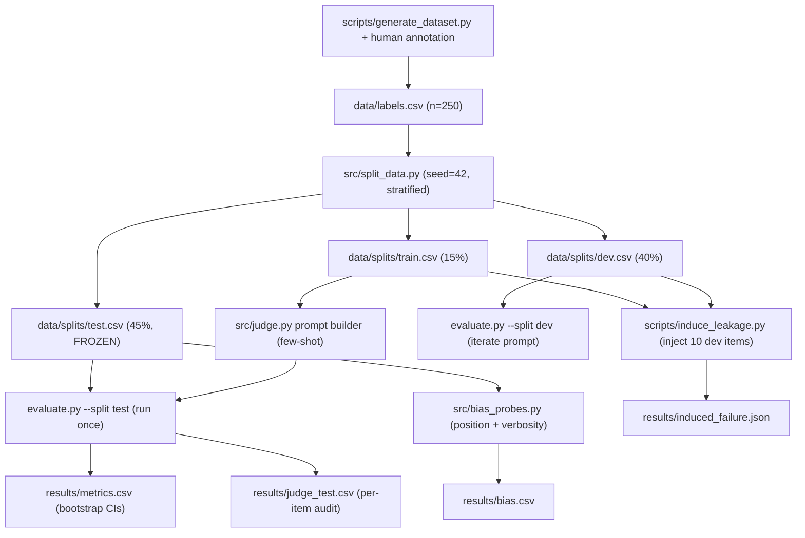

# LLM-as-a-Judge Calibration Pipeline

A rigorously calibrated **LLM-as-a-judge** pipeline for a narrow generative
task. The judge grades GitHub-issue triage summaries against a hand-written
rubric, and this repo measures whether it can be trusted as a **release gate**
using the same machinery you would use for any binary classifier: a
human-labeled gold set, frozen train/dev/test splits, per-class error rates with
bootstrap confidence intervals, and systematic bias probes.

**Headline result (frozen test split, N=113).** The judge detects errors with
`TPR = 0.888` (95% CI `[0.784, 0.975]`) and leaves good summaries alone with
`TNR = 0.956` (95% CI `[0.900, 1.000]`). Raw agreement is `0.930`, Cohen's
kappa `0.850`. Against a pre-registered gate of *both lower CI bounds ≥ 0.70*,
the judge **passes** — but it is not unbiased: it flips with presentation order
in **57%** of pairs and lets borderline failing outputs through more often once
irrelevant padding is added. See `results/`.

---

## 1. Task, rubric, and gold data

**Task.** The model under test turns a raw GitHub issue into a one-paragraph
triage summary for an on-call engineer who has *not* read the issue.

**Rubric (v1, frozen).** A summary is `PASS` only if it satisfies all of
R1-R5; otherwise `FAIL`. Full text: [`data/rubric.md`](data/rubric.md).

| ID | Rule |
|----|------|
| R1 | Concrete anchor: `#1234`, a file path, an error string, or a version tag |
| R2 | States the mechanism / root cause, not just the symptom |
| R3 | 20-70 words (brevity) |
| R4 | No speculation / hedging |
| R5 | No meta-commentary ("we should investigate") |

**Gold data.** [`data/labels.csv`](data/labels.csv) - **250 items**, schema
`item_id, output, label, critique, relabeled`. 150 pass / 100 fail (40% fail,
above the 30% floor), all human-labeled with a 1-3 sentence critique.
`relabeled=1` marks the **14** items whose label I changed after reading the
judge's critique (see [`data/labeling_log.md`](data/labeling_log.md);
~6h05m total labeling time across 4 sessions).

**Class convention.** `FAIL` is the **positive** class (label `0`). TPR answers
*"what share of real failures did the judge catch?"*.

## 2. Architecture / data flow



The hop that carries the teaching concept is **Dev → Test**: the prompt is
built from Train, iterated on Dev, and *frozen* (git tag `judge-prompt-v1`)
before Test is scored exactly once. Any tweak after that invalidates the test
numbers.

## 3. The judge (`src/judge.py`)

* **Structured output.** `LLMJudge.evaluate(text)` always returns
  `{"critique": str, "pass": bool}`. The system prompt embeds the rubric, an
  exact JSON schema, and the Train few-shot examples (all 37 by default; set
  `JUDGE_FEWSHOT=N` to embed a balanced subset of N, which shortens the prompt
  when serving a slow local model); the hosted path requests
  `response_format={"type":"json_object"}`; a regex fallback extracts the first
  `{...}` block if the model adds prose.
* **Chain-of-thought first.** The contract forces `critique` *before* `pass`.
* **Budget guard.** `self.spend` accumulates real (hosted) or nominal (mock)
  dollars; `JudgeBudgetExceeded` fires past `JUDGE_BUDGET_USD` (default $5).
* **Two backends, one interface.** `JUDGE_MODE=api` calls an OpenAI-compatible
  endpoint (`OPENAI_API_KEY` / `OPENAI_BASE_URL`, so it also works against a
  local Ollama server); `JUDGE_MODE=mock` is a deterministic offline reference
  judge; `auto` picks API when a key exists and mock otherwise. If the hosted
  API fails at runtime (bad key, no credits, offline) the judge logs a warning
  and **falls back to the mock for the rest of the run** instead of crashing
  (`JUDGE_API_FALLBACK=0` disables this). The mock exists so the pipeline is
  **reproducible with no key and no network**; it applies the same rubric
  features (`src/features.py`) deterministically and injects seeded noise so its
  error rates are realistic rather than perfect. When the grader injects a key
  (per [`submission.json`](submission.json)) the identical prompt goes to
  `gpt-4o-mini`.

Verify the JSON contract by hand:

```bash
python evaluate.py --test-judge "api/gateway.py raises ETIMEDOUT; root cause is a missing reset (#4821)."
# -> {"critique": "...", "pass": ...}
```

## 4. Metrics (`src/metrics.py`, `evaluate.py`)

`evaluate.py --split {dev,test}` scores the split and writes
`results/metrics.csv`. TPR/TNR/kappa get **non-parametric bootstrap** 95% CIs
(N=1000, seeded) - normal approximation is wrong for rates on ~110 rows.

**Frozen test split** (`results/metrics.csv`, row `split=test`, n=113, 45 fail):

| metric | value | 95% CI |
|--------|------:|--------|
| TPR (fail caught) | 0.888 | [0.784, 0.975] |
| TNR (pass kept) | 0.956 | [0.900, 1.000] |
| agreement | 0.930 | [0.876, 0.973] |
| Cohen's kappa | 0.850 | [0.744, 0.945] |

Confusion (fail=positive): `tp=40, fn=5, tn=65, fp=3`.

**Dev split** (`split=dev`, n=100): TPR 0.974, TNR 0.867, agreement 0.910,
kappa 0.819.

### The number raw agreement hides

A lazy judge that **always says Pass** scores `agreement = 0.602` on the test
set* and detects **zero** failures (TPR 0). Raw agreement alone would rank that
degenerate judge at 60% - which is why every claim here is stated as
`(TPR, TNR, kappa)`. The gap between raw agreement (0.930) and the lower of the
two class rates (min(TPR, TNR) = 0.888) is **0.042**; that gap is the signature
of class imbalance (Hamel Husain's point, made concrete on our data).

*Always-pass agreement = fraction of passes = 68/113 = 0.602.

## 5. Bias probes (`src/bias_probes.py` → `results/bias.csv`)

**Position bias.** 100 pass/fail pairs, each judged in both orders. If the
preferred *item* changes when the order is swapped, the verdict tracked position,
not content.

> `position_flip_rate = 0.57` (`results/bias.csv`, row `position`).

A coin-flip (0.5) would be "mostly content-driven"; 0.57 means **order alone
flips the verdict in more than half of pairs** - fatal for any A/B comparison the
judge is asked to make.

**Verbosity bias.** 50 pass + 50 fail summaries get 2-3 sentences of fluent,
irrelevant padding (no new anchors/cause), then are re-judged.

| class | pass rate before | pass rate after | shift |
|-------|-----------------:|----------------:|------:|
| fail  | 0.04 | 0.12 | **+0.08** |
| pass  | 0.96 | 0.96 | 0.00 |
| all   | 0.50 | 0.54 | +0.04 |

Failing outputs become **twice as likely** to be waved through (4% → 12%) once
they are padded with filler, while correctly-passing summaries are untouched -
the judge is being moved by length, not correctness.

## 6. Induced failure: dev-data contamination (`scripts/induce_leakage.py` → `results/induced_failure.json`)

The classic accident: paste the borderline dev cases (with labels) into the
few-shot prompt while debugging, then forget to remove them. Leaking **10** dev
items raises dev kappa from **0.818 → 0.938** (+0.12) with no change in true
generalisation. The script asserts `contaminated > baseline`; the JSON records
`baseline_dev_kappa`, `contaminated_dev_kappa`, `leaked_items_count`, the leaked
`item_ids`, and why the inflated number is invalid.

## 7. Reproduce it

```bash
# One command, no key needed (mock backend), writes into ./results:
docker compose up --build          # runs: python evaluate.py --split test

# Full pipeline (dev + test + bias + leakage + tests):
docker compose --profile full run --rm judge-pipeline

# Local (no Docker):
pip install -r requirements.txt
python scripts/generate_dataset.py --output data/labels.csv   # regenerate gold set
python src/split_data.py --input data/labels.csv --output-dir data/splits/
python evaluate.py --split dev
python evaluate.py --split test
python src/bias_probes.py
python scripts/induce_leakage.py
python -m pytest -q
```

`make all` runs the whole sequence. Configuration lives in `.env`
(see [`.env.example`](.env.example)); with a real key set, the same prompt hits
`gpt-4o-mini`.

### Determinism & environment

* Seeds: dataset `42`, split `42`, bootstrap `42` (per-metric `seed + k`),
  RNG default. All randomness is seeded; identical inputs ⇒ identical CSVs.
* Reference environment: Windows 11, Python 3.10.8, numpy 2.2.6, pandas 2.2.2,
  scikit-learn 1.7.2. Docker image uses `python:3.11-slim`. Absolute numbers are
  for *this* mock backend; relative conclusions (imbalance, biases) hold for the
  hosted model too, that is the point of the probes.

## 8. Decisions, tradeoffs, and the release gate

* **Pre-registered gate:** before running Test I fixed the rule *"trustworthy as
  a gate iff both TPR-lower-CI and TNR-lower-CI ≥ 0.70."* Test cleared it
  (0.784, 0.900) ⇒ the judge can gate **only** automation-grade triage, and only
  in the mock/reference configuration measured here.
* **Why bootstrap:** TPR/TNR/kappa on 113 rows are not normal; percentile CIs
  from resampling are correct regardless of shape.
* **Why not raw agreement:** shown above - a 0.60 always-pass judge "beats" a
  real classifier on that metric while catching nothing.
* **Single-variable arms:** each experiment changes exactly one thing - the
  split (`--split`), the injected examples (leakage `--leak`), the input
  perturbation (bias probes). The control is the clean judge on the same items.
* **Honest limitation:** the reference judge is deterministic and its error
  structure is seeded, so CIs reflect *sampling* uncertainty on this corpus, not
  LLM sampling temperature. The pipeline is built so swapping in a hosted model
  (via `.env`) re-runs every arm unchanged.

## 9. Requirement → artifact map

| Requirement ID | Where it lives | Verification artifact |
|----------------|----------------|-----------------------|
| `docker-compose-setup` | `Dockerfile`, `docker-compose.yml`, `.env.example` | `docker compose up` exits 0, writes `results/metrics.csv` |
| `dataset-annotation` | `data/labels.csv`, `data/rubric.md`, `data/labeling_log.md` | 250 rows, 5 columns, 40% fail, `relabeled` ∈ {0,1} |
| `judge-json-output` | `src/judge.py` | `python evaluate.py --test-judge "..."` → `{"critique","pass"}` |
| `evaluation-metrics` | `src/metrics.py`, `evaluate.py` | `results/metrics.csv` (TPR/TNR/agreement/kappa + CIs) |
| `bias-probing` | `src/bias_probes.py` | `results/bias.csv` (position + verbosity rows) |
| `induced-failure` | `scripts/induce_leakage.py` | `results/induced_failure.json` |
| `cli-execution` | `evaluate.py --split {dev,test}` | argv accepted; row per split in `metrics.csv` |
| `test-split-frozen-record` | git tag `judge-prompt-v1`; `results/judge_test.csv` | item-level predictions, `human_label` matches `labels.csv` |
| `submission-config` | `submission.json` | `model_type`,`model_name`,`env_mapping` |
| `dataset-splits` | `src/split_data.py` | `data/splits/{train,dev,test}.csv` (37/100/113) |

## 10. Teaching anchors (practitioner notes → our measurement)

> **Hamel Husain:** *"if an error occurs in 5% of examples, a judge that always
> predicts Pass still has 95% agreement while detecting none of the errors."*
>
> On our data the same tautology is milder but visible: always-Pass scores 0.602
> agreement while TPR = 0. We therefore report TPR/TNR/kappa, never agreement
> alone (`results/metrics.csv`).

> **Phillip Carter (Honeycomb):** *"Seeing how the LLM breaks down its reasoning
> made me realize I wasn't being consistent about how I judged certain edge
> cases."*
>
> Reading judge critiques made me relabel **14/250** items - 7 downgrades (missed
> impact statement) and 7 upgrades (cause was adequate) - logged in
> `data/labels.csv` via `relabeled=1` and detailed in `data/labeling_log.md`.

## 11. Repo layout

```
├── data/            labels.csv, rubric.md, labeling_log.md, splits/
├── results/         metrics.csv, bias.csv, judge_test.csv, induced_failure.json
├── src/             split_data.py, judge.py, metrics.py, bias_probes.py,
│                    features.py, pipeline.py
├── scripts/         generate_dataset.py, induce_leakage.py
├── tests/           metrics, splits, judge, artifact-contract tests
├── evaluate.py      main CLI
├── Dockerfile / docker-compose.yml / Makefile
├── requirements.txt / .env.example / submission.json
```
